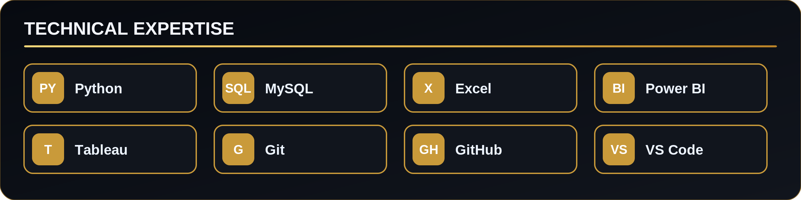
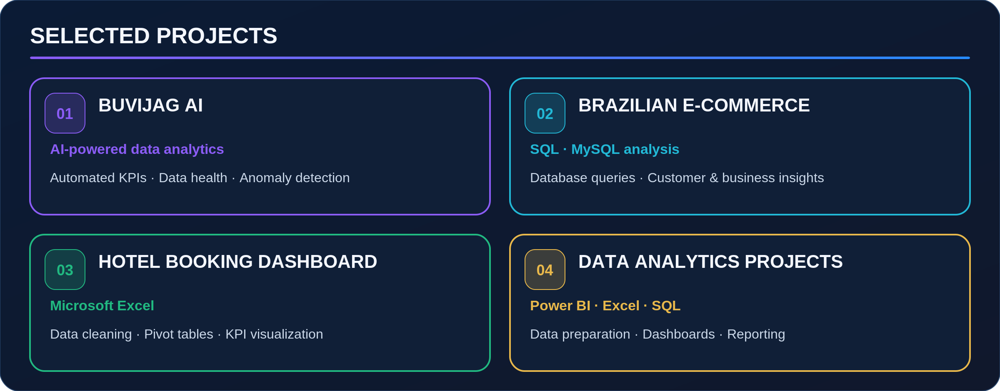
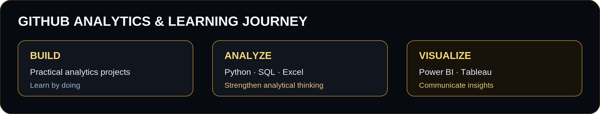

```html
<div align="center">


<a href="https://www.linkedin.com/in/vincen-m-bb6429217/"></a>
<a href="https://github.com/vincen1608"></a>

</div>

---

## ABOUT ME

I'm **Vincen M**, an aspiring Data Analyst currently pursuing Data Analytics training at **IT Vedant**.

I enjoy exploring datasets, identifying patterns, solving analytical problems, and transforming raw information into meaningful business insights.

- Building practical data analytics projects.
- Exploring datasets using Python and SQL.
- Creating dashboards with Excel and Power BI.
- Continuously improving my analytical and problem-solving skills.

---

<div align="center">
  
</div>

---

<div align="center">
  
</div>

### PROJECT DETAILS

| Project | Tools | Highlights |
|---|---|---|
| BUVIJAG AI | Python, Streamlit, AI | KPI detection, data health, anomaly detection and insights |
| Brazilian E-Commerce | SQL, MySQL | Database analysis and business exploration |
| Hotel Booking Dashboard | Excel | Data cleaning, Pivot Tables and KPI dashboard |
| Data Analytics Projects | Power BI, Excel, SQL | Data preparation, visualization and reporting |

---

<div align="center">
  
</div>

## GITHUB STATISTICS

<div align="center">


</div>

---

## CURRENT LEARNING

- **Python:** Data analysis and manipulation
- **SQL:** Querying and database analysis
- **Power BI:** Interactive dashboards
- **Tableau:** Data visualization
- **Excel:** Advanced analytics and reporting

---

<div align="center">

## LET'S CONNECT

Open to learning, collaboration and opportunities in Data Analytics.

<a href="https://www.linkedin.com/in/vincen-m-bb6429217/"></a>
<a href="https://github.com/vincen1608"></a>

**LEARN · ANALYZE · CREATE**

</div>
```
