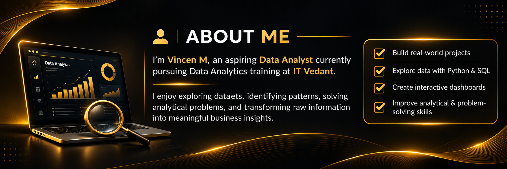
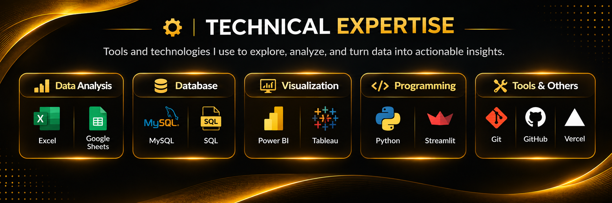

# Vincen — Black & Gold GitHub Profile README Assets

All section PNGs are standalone images at 2172 × 724 px. Copy these PNGs into the root of the `vincen1608/vincen1608` repository, alongside `README.md`.

## README image sections

```html
<p align="center">
  
</p>

<p align="center">
  
  
  
  
  
</p>
```

## Dynamic GitHub cards (add separately; no static GitHub stats image included)

```html
<p align="center">
  
  
</p>
```

## Contact section

```html
<p align="center">
  
</p>
```

**Before publishing:** the QR code printed inside `07-lets-connect.png` is decorative/generated and is not guaranteed to scan. Replace it with a real LinkedIn QR code or cover that area. Check all displayed contact text before committing.
